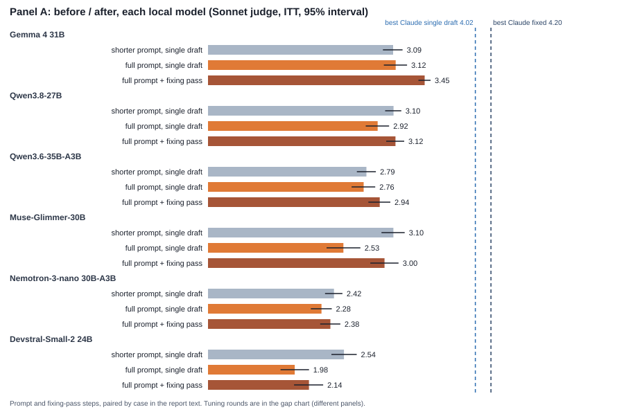
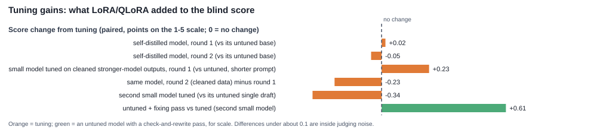
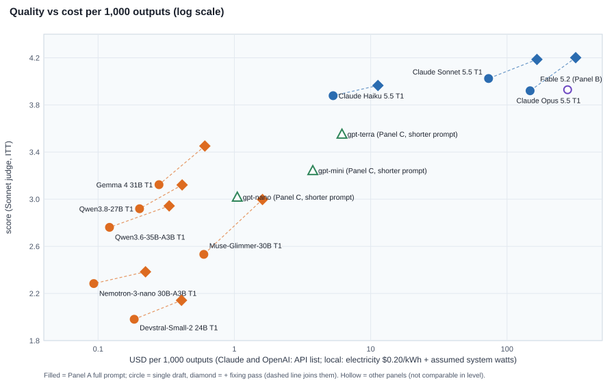

# Generative Writer Evaluation: Quality, Cost and Speed Across Cloud and Local Models

> **Which model should write short personalised advisory notes from structured facts, what does each quality level cost, and how far can prompting, a fixing pass and LoRA tuning lift a local model on one consumer GPU?**

**Lab brief:** https://tayler-erbe.github.io/generative-writer-evaluation/brief/

This repository holds the public, aggregate results of a writer-model evaluation: three hosted Claude models and six open-weight models on a single RTX 5090, scored on 120 fabricated test cases by a blind AI judge. The task is described generically: from a set of structured facts and a reader's goal, write a short personalised advisory note (about 150 words, one title, one paragraph, one concrete closing action).

The headline: **the three hosted models led and overlapped one another (best cell 4.20 on a 1 to 5 scale); the best local setup, Gemma 4 31B with a fixing pass, scored 3.45 (82% of the top cell) for $0.61 per 1,000 outputs in electricity.** The fixing pass raised every model. LoRA and QLoRA tuning taught the output rules but did not raise blind quality.

**Read the scores as AI-judge screening evidence, not measured accuracy.** The judge (Claude Sonnet) passed a planted-control check, but anchoring it to blind human picks is pending.

---

## What was tested

| Item | Detail |
|---|---|
| Test set | 120 fabricated cases across eleven scenario categories, sealed by hash before any model ran |
| Prompt | Identical long prompt for every model (about 14,000 tokens); a shorter prompt (about 4,000 tokens) for the local models |
| Hosted models | Claude Haiku 5.5, Sonnet 5.5, Opus 5.5 (one draw per case) |
| Local models | Gemma 4 31B, Qwen3.8-27B, Qwen3.6-35B-A3B, Muse-Glimmer-30B, Nemotron-3-nano 30B-A3B, Devstral-Small-2 24B (two draws per case, one RTX 5090) |
| Tracks | Single draft; draft + fixing pass (the model checks its draft against the facts and rewrites it, at most two rounds, kept only if faults fall) |
| Judge | Claude Sonnet, six-dimension anchored rubric (task fit, faithfulness, insight, specificity, fluency, epistemic care), 1 to 5, blind mixed sets, shuffled labels, planted controls |
| Scoring | Failed or hard-failed outputs score 1 on every dimension (intention to treat); 95% case-cluster bootstrap intervals |

A second, local judge failed the planted-control check (it rewarded scrambled text) and is not used for any number here.

### Panels: never compare across them

| Panel | What it is |
|---|---|
| A | Headline run: full prompt, 120 cases, both tracks (all numbers below unless stated) |
| B | Earlier full-prompt re-run in a separate judging session; adds Claude Fable 5.2 |
| C | Earlier shorter-prompt run; adds three OpenAI models (30 cases single draft, 10 cases with the fixing pass) |
| D / E | Tuning measurements on a 71-case secondary set and on the 120 cases |

The same Claude model scored up to 0.36 differently between Panels A and B on identical cases.

---

## Quality (Panel A, full prompt)

| Model | Route | Single draft [95%] | Draft + fixing pass [95%] | Hard-fail, single / with pass |
|---|---|---|---|---|
| Claude Opus 5.5 | hosted | 3.92 [3.73, 4.09] | **4.20** [4.09, 4.30] | 0.100 / 0.025 |
| Claude Sonnet 5.5 | hosted | 4.02 [3.85, 4.18] | 4.19 [4.06, 4.29] | 0.075 / 0.033 |
| Claude Haiku 5.5 | hosted | 3.88 [3.73, 4.02] | 3.96 [3.83, 4.08] | 0.067 / 0.042 |
| Gemma 4 31B | local | 3.12 [2.99, 3.25] | **3.45** [3.38, 3.52] | 0.158 / 0.029 |
| Qwen3.8-27B | local | 2.92 [2.78, 3.05] | 3.12 [3.02, 3.22] | 0.179 / 0.113 |
| Muse-Glimmer-30B | local | 2.53 [2.34, 2.72] | 3.00 [2.84, 3.15] | 0.425 / 0.246 |
| Qwen3.6-35B-A3B | local | 2.76 [2.62, 2.89] | 2.94 [2.81, 3.06] | 0.208 / 0.133 |
| Nemotron-3-nano 30B-A3B | local | 2.28 [2.16, 2.40] | 2.38 [2.27, 2.50] | 0.258 / 0.188 |
| Devstral-Small-2 24B | local | 1.98 [1.82, 2.14] | 2.14 [1.97, 2.30] | 0.537 / 0.458 |

---

## Improving the local models

- **Prompt length (Panel A):** the long prompt hurt Muse-Glimmer (-0.56), Devstral (-0.56) and Qwen3.8 (-0.18) on single drafts; local hard-fail rates roughly doubled on it.
- **Fixing pass (Panel A):** raised every model (Gemma +0.33 [0.22, 0.44], Muse-Glimmer +0.47 [0.34, 0.60]), mainly by rescuing outputs that had broken a rule; scores on valid outputs barely moved.
- **Other pipeline steps (Qwen3.8-27B, 71 cases, Panel D):** plan-first -0.168; strict in-prompt rule +0.048; best-of-4 +0.034 (inside noise); check-and-rewrite -0.006. Together about +0.04.
- **LoRA / QLoRA (Panels D and E):** taught output rules (hard-rule failures 41 of 71 to 10 of 71 for one model), removed habits it was shown, and cost about 14% throughput when served; it did not raise blind quality. Self-distillation: +0.02, then -0.05 to -0.07. A second model: tuned minus untuned -0.34 [-0.51, -0.16]. The learning curve was flat from 27 to 64 training examples.

**ESTIMATE, not a measurement:** with several hundred to a few thousand examples written to the target standard by a stronger source, a clean picker and a preference stage (not tested), a 27 to 31B model might reach about 3.4 to 3.7 on Panel A's scale, still about 0.4 to 0.9 below the best hosted single draft (4.02). More of the same data is expected to add roughly nothing.

---

## Cost

`cost(N) = N × c`

- **Hosted API:** `c = (input tokens × P_in + output tokens × P_out) / 1,000,000`, summed over calls; batch = 0.5 × list. Prices checked 17 Nov 2026 (Anthropic) and 19 Nov 2026 (OpenAI); later prices unverified.
- **Local GPU:** `c = GPU-seconds × (P_gpu + P_system) / 3,600,000 × r + GPU-hours × A`. `r` = electricity rate (tables use $0.20/kWh), `P_gpu` measured (414 to 571 W under load), `P_system` an **assumed** 150 W, `A` optional amortisation (reader's own parameters; the data file's amortisation column is **illustrative**: $3,000 over 3 years at 50% use).

| Setup | 1,000 | 10,000 | 100,000 | 1,000,000 |
|---|---|---|---|---|
| Claude Haiku 5.5, single draft, API list | $5.30 | $53.00 | $530 | $5,300 |
| Claude Haiku 5.5, single draft, API batch | $2.65 | $26.50 | $265 | $2,650 |
| Claude Sonnet 5.5, single draft, API list | $73.20 | $732 | $7,320 | $73,200 |
| Claude Opus 5.5 + fixing pass, API list | $318.80 | $3,188 | $31,880 | $318,800 |
| Gemma 4 31B local + fixing pass (electricity) | $0.61 | $6.07 | $60.71 | $607 |
| Qwen3.8-27B local, single draft (electricity) | $0.20 | $2.02 | $20.16 | $202 |

OpenAI rows in `data/` are **estimates** on a quoted token basis; their quality at the full prompt was not measured.

### Cheapest setup per quality bar (Panel A)

| Bar | Setup | Score | Cost per 1,000 |
|---|---|---|---|
| 3.0 | Qwen3.8-27B, shorter prompt, single draft | 3.10 | $0.09 |
| 3.3 | Gemma 4 31B, with fixing pass | 3.45 | $0.61 |
| 3.5 and 3.7 | Claude Haiku 5.5, single draft | 3.88 | $5.30 |
| 4.0 | Claude Sonnet 5.5, single draft | 4.02 | $73.20 |
| 4.2 | Claude Opus 5.5, with fixing pass | 4.20 | $318.80 |

No local setup reached 3.5. Differences of 0.1 are inside judging noise.

---

## Speed (full prompt, single draft)

| Model | Route | p50 / p95 latency (s) | Outputs per hour |
|---|---|---|---|
| Claude Sonnet 5.5 | hosted, 3 parallel | 23.5 / 29.0 | 460 (derived) |
| Claude Opus 5.5 | hosted, 3 parallel | 30.5 / 45.5 | 344 (derived) |
| Claude Haiku 5.5 | hosted, 3 parallel | 26.4 / 46.4 | 380 (derived) |
| Nemotron-3-nano 30B-A3B | local, 2 parallel | 3.5 / 5.5 | 1,392 |
| Qwen3.6-35B-A3B | local, 2 parallel | 5.0 / 7.6 | 930 |
| Qwen3.8-27B | local, 2 parallel | 12.9 / 18.7 | 614 |
| Gemma 4 31B | local, 2 parallel | 14.8 / 18.4 | 480 |
| Muse-Glimmer-30B | local, 2 parallel | 27.5 / 40.5 | 242 |

Full table, including Claude Fable 5.2 and Devstral, in `data/throughput_latency.csv`.

---

## Limits

- Scores come from an AI judge that is not yet anchored to human picks; the judge is from one of the compared model families.
- Panels are not comparable in level; hosted arms had one draw, local arms two; tuning rounds are single runs on 47 to 96 examples.
- Local wall power was not measured (150 W system power assumed); electricity and amortisation are the reader's parameters.
- Prices are dated; OpenAI models at the full prompt, the OpenAI judge, second hosted draws and best-of-N at the full prompt are not in this edition.
- All cases are fabricated. Test cases, prompts and model outputs are not published.

---

## Repository layout

| Path | Contents |
|---|---|
| `brief/` | The Lab brief (static HTML; shared Lab stylesheets `styles.css` and `site.css`, brief styles in `study.css`) |
| `brief/charts/` | The five public figures (SVG) |
| `data/leaderboard_panelA_full_prompt.csv` | Panel A scores, intervals and hard-fail rates |
| `data/quality_vs_cost_panelA.csv` | Every Panel A setup: score, share of the top cell, cost per 1,000, GPU-hours, outputs per hour |
| `data/cost_per_1000_hosted.csv` | Hosted cost per 1,000 outputs (Claude measured; OpenAI estimates) |
| `data/cost_per_1000_local.csv` | Local GPU time, energy and electricity cost per 1,000 outputs, both prompts and tracks, plus an illustrative amortisation column |
| `data/cost_for_N.csv` | Cost for 1,000 to 1,000,000 outputs by setup |
| `data/throughput_latency.csv` | Latency and outputs per hour |

---

*Tayler Erbe · Applied AI Lab · November 2026*
